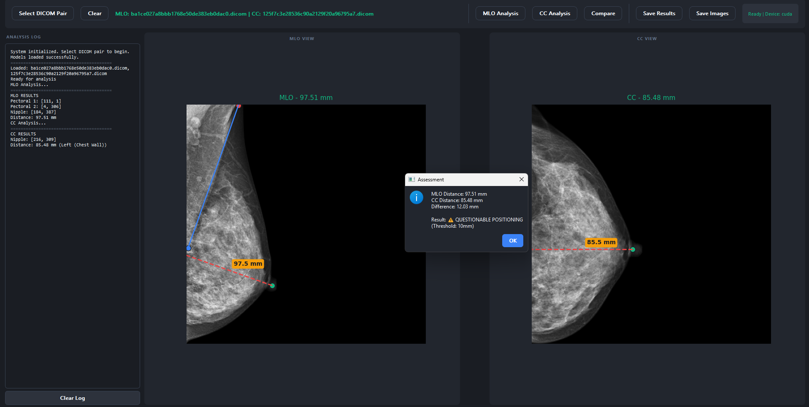

# Deep Mammography GUI

<div align="center">

**A deep learning-powered desktop application for automated mammography positioning quality assessment.**


</div>

---

## Overview

This desktop application provides automated analysis of mammogram positioning quality for both **MLO** (Mediolateral Oblique) and **CC** (Craniocaudal) views. Using deep learning models built on a **CRAUNet** architecture, the system detects anatomical landmarks and evaluates positioning accuracy based on the clinical **10 mm rule**.

> **Model Architecture**: The segmentation and landmark detection models are based on the **CRAUNet** (Channel-wise and Residual Attention U-Net) architecture. For the full training pipeline, model weights, and evaluation code, see the companion repository:
> 🔗 [enescanerkan/deep-mammography-positioning](https://github.com/enescanerkan/deep-mammography-positioning)

---

## GUI Preview



*The application showing MLO (left) and CC (right) analyses with measurement overlays and the positioning assessment dialog.*

---

## Download Pre-built Application

> 💾 **No Python installation required!**

Download the pre-built Windows executable directly from Google Drive:

**[⬇️ Download deep-mammography-gui.exe](https://drive.google.com/file/d/1wOCBpIecmU5FSaWxSmtfrTfTWVyJ1ooh/view?usp=sharing)**

After downloading, place the `.exe` alongside the `weights/` folder and run directly.

---

## Features

| Feature | Description |
|---|---|
| **MLO Analysis** | Detects 3 landmarks (2 pectoral boundary points + nipple), calculates the perpendicular distance (PNL) |
| **CC Analysis** | Detects nipple position, calculates distance to the chest wall |
| **10 mm Rule** | Compares MLO and CC PNL distances for clinical positioning assessment |
| **DICOM Support** | Direct DICOM file loading with automatic pixel spacing extraction |
| **Dark UI** | Professional dark-themed PyQt5 interface with measurement overlays |
| **CUDA Support** | Automatic GPU acceleration when available |

---

## Project Structure

```
mammogram-positioning-analysis/
├── src/
│   ├── main.py                   # Application entry point
│   ├── analysis/                 # Geometric analysis modules (PNL calculation)
│   ├── data/                     # DICOM data loading and management
│   ├── gui/                      # PyQt5 main window and widgets
│   ├── models/                   # Model manager (loads CRAUNet weights)
│   ├── networks/                 # Neural network definitions (CRAUNet)
│   ├── preprocessing/            # Image preprocessing pipeline
│   └── utils/                    # Shared utilities
├── weights/                      # Model weight files (.pth) — download separately
├── results/                      # Output directory for saved results
├── build.py                      # PyInstaller build script
├── requirements.txt
└── README.md
```

---

## Installation (From Source)

```bash
# Clone the repository
git clone https://github.com/enescanerkan/deep-mammography-gui.git
cd deep-mammography-gui

# Create and activate a virtual environment
python -m venv venv
venv\Scripts\activate       # Windows
# source venv/bin/activate  # Linux / macOS

# Install dependencies
pip install -r requirements.txt
```

---

## Model Weights

The model weights are **not included** in this repository due to their size. Place the pre-trained weight files in the `weights/` directory before running:

```
weights/
├── mlo_craunet.pth    # MLO view — landmark detection model
└── cc_craunet.pth     # CC view  — landmark detection model
```

> The weights were produced by the training pipeline in the companion repository:
> 🔗 [enescanerkan/deep-mammography-positioning](https://github.com/enescanerkan/deep-mammography-positioning)

---

## Usage

### Run from source

```bash
python src/main.py
```

### Workflow

1. Click **"Select DICOM Pair"** — load one MLO and one CC DICOM file.
2. Click **"MLO Analysis"** — runs landmark detection and displays the PNL distance overlay.
3. Click **"CC Analysis"** — detects nipple and measures distance to the chest wall.
4. Click **"Compare"** — evaluates the 10 mm rule and shows the positioning assessment dialog.
5. Click **"Save Results"** or **"Save Images"** to export findings.

---

## Architecture

The neural networks in `src/networks/` implement the **CRAUNet** (Channel-wise Residual Attention U-Net) architecture. The model integrates:

- **Residual encoder blocks** for robust feature extraction
- **Channel-wise attention gates** to suppress irrelevant anatomical regions
- **Skip connections** for high-resolution spatial detail recovery
- **Sigmoid output head** for heatmap-based landmark localization

The full architecture description and ablation study results are available in the companion training repository.

---

## Requirements

- Python 3.8+
- PyTorch 1.12+
- PyQt5 5.15+
- pydicom
- OpenCV
- NumPy
- CUDA-capable GPU *(optional — CPU inference is supported)*

See [`requirements.txt`](requirements.txt) for the exact dependency list.

---

## Building the Executable

To rebuild the Windows `.exe` yourself:

```bash
pip install pyinstaller
python build.py
```

The output will be placed in the `dist/` directory.

---

## Related Repository

| Repository | Description |
|---|---|
| [deep-mammography-positioning](https://github.com/enescanerkan/deep-mammography-positioning) | YOLO-based positioning evaluation pipeline — training, evaluation, and dataset tools |

---

## License

This project is licensed under the **MIT License** — see the [LICENSE](LICENSE) file for details.
